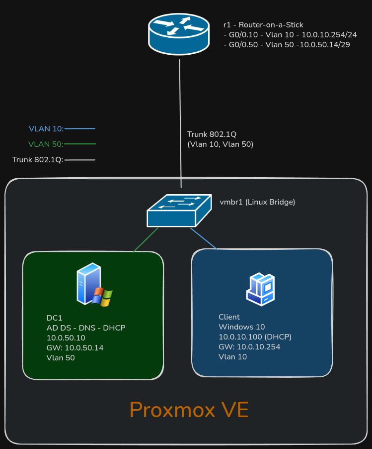
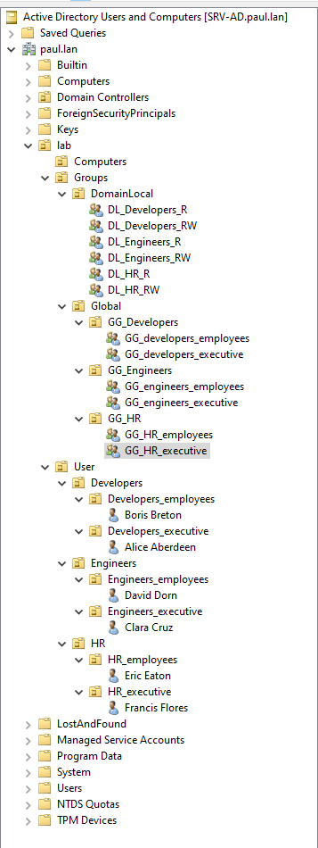
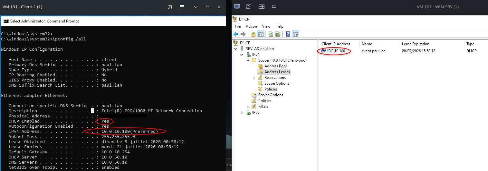
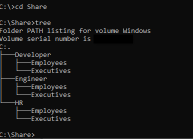
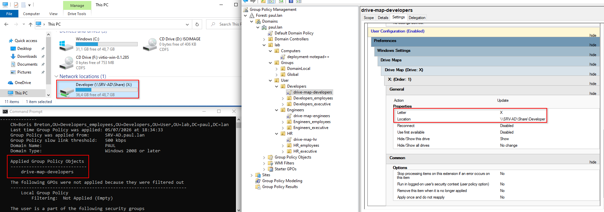
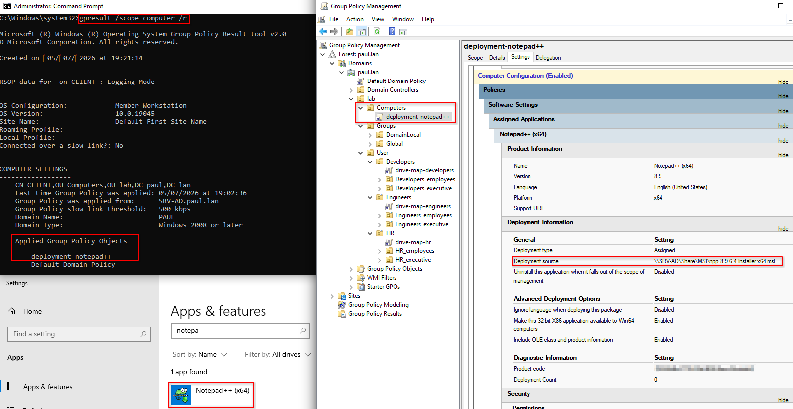
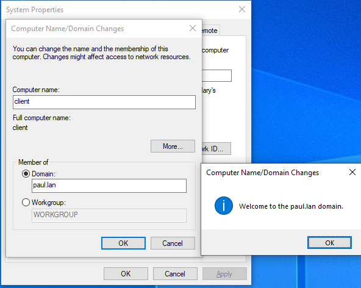
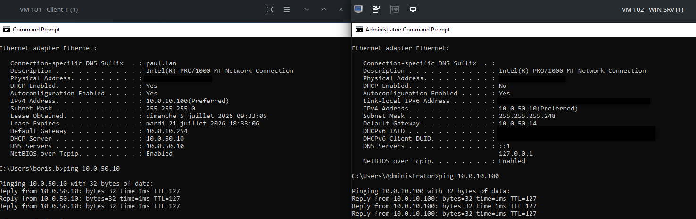
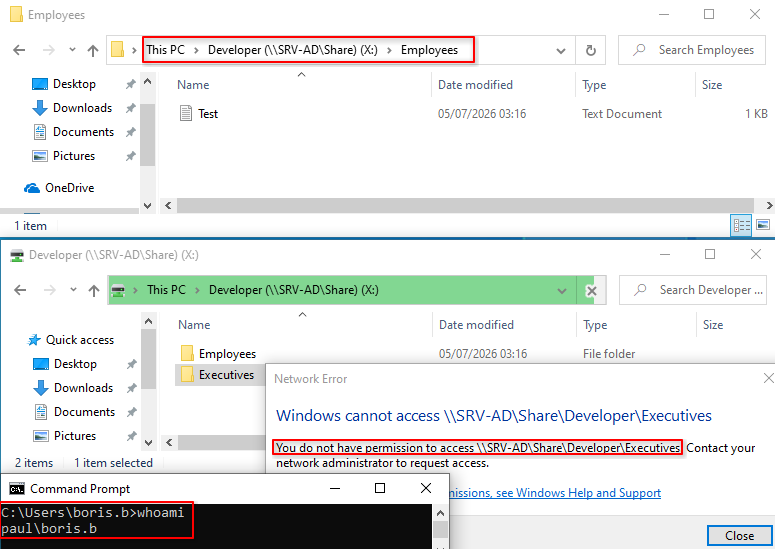

# Lab 3 - Active Directory Infrastructure Deployment

 

Designed and deployed a Windows Server Active Directory infrastructure featuring DNS, DHCP, VLAN segmentation, centralized authentication, AGDLP-based access control, SMB file sharing, NTFS permissions, and Group Policy management.

 

**Technologies:** Windows Server 2022 • Active Directory (AD DS) • DNS • DHCP • Cisco IOS • Proxmox VE • GPO • SMB • NTFS

## Table of Contents

- [Objectives](#objectives)
- [Infrastructure](#infrastructure)
- [Network Topology](#network-topology)
- [Active Directory Architecture](#active-directory-architecture)
- [Configuration](#configuration)
- [Validation](#validation)
- [Challenges Encountered](#challenges-encountered)
- [Lessons Learned](#lessons-learned)
- [Future Improvements](#future-improvements)

## Objectives

The objective of this project was to design and deploy a realistic Active Directory infrastructure simulating a small enterprise environment.

**This projet demonstrates:**

- Implementing role-based access control following the AGDLP model.
- Securing shared folders using NTFS permissions.
- Configuring Group Policy Objects (GPOs) to automate administrative tasks.
- Centralizing network services through Active Directory, including DNS and DHCP.

## Infrastructure

This lab runs on a mini PC hosting Proxmox VE with two physical network interfaces. 
One interface is connected to my home network for management, while the second is connected to a Cisco router configured for Router-on-a-Stick (RoaS). 
Virtual machines communicate through a Proxmox Linux bridge, which forwards 802.1Q tagged traffic to the router. 
The router performs inter-VLAN routing between the configured VLANs.

### IP Addressing

| Component | IP Address | VLAN | Assignment |
|-----------|------------|------|------------|
| Windows Server 2022 | 10.0.50.10 | 50 | Static |
| Windows 10 Client | 10.0.10.100 | 10 | DHCP |
| Router g0/0.50 | 10.0.50.14 | 50 | Gateway |
| Router g0/0.10 | 10.0.10.254 | 10 | Gateway |

## Network Topology

The following diagram illustrates the network architecture of the lab. To better simulate an enterprise environment, client and server systems are separated into dedicated VLANs. Inter-VLAN routing is performed using a Cisco Router-on-a-Stick (RoaS) configuration.

## Active Directory Architecture

The Active Directory environment is organized into dedicated Organizational Units (OUs) for users, groups, and computers. Security groups follow the AGDLP model to provide structured and scalable permission management.

## Configuration 

**Router configuration:** [`configs/r1.cfg`](configs/r1.cfg)

### Domain Services

A Windows Server 2022 virtual machine was promoted to a Domain Controller for the `paul.lan` domain. The Active Directory Domain Services (AD DS), DNS, and DHCP roles were installed to provide centralized authentication, name resolution, and IP address management.

### DHCP

A DHCP scope was configured to provide IP addresses to clients located in VLAN 10. DHCP Relay (`ip helper-address`) was configured on the Cisco Router-on-a-Stick, allowing DHCP requests to reach the server located in VLAN 50. Clients automatically receive their IP address, default gateway, DNS server, and domain suffix.

### File Server

A centralized SMB share was created to host departmental folders for Developers, Engineers, and HR. Access control follows the AGDLP model, where users are assigned to Global Groups, Global Groups are nested into Domain Local Groups, and NTFS permissions are applied to the Domain Local Groups.

### Group Policy

#### Drive Mapping

A Group Policy Preference automatically maps the appropriate departmental network share as a drive when a user signs in. This removes the need for manual configuration while ensuring users only access resources relevant to their department.

#### Software Deployment

A Computer Configuration Group Policy was used to deploy the Notepad++ MSI package to domain-joined workstations. The installation is performed automatically during system startup from a shared network location.

## Validation

The following tests were performed to verify that the infrastructure operates as expected.

### Domain Authentication

The Windows 10 client was successfully joined to the `paul.lan` domain, confirming proper communication with Active Directory Domain Services and DNS.

### DHCP & Network Connectivity

The client successfully received its network configuration from the DHCP server through DHCP Relay. Successful ping tests between the client and the domain controller confirm that inter-VLAN routing is working correctly.

### NTFS Authorization

Folder permissions were validated using accounts from different departments. Users can access only the resources assigned to their department, while unauthorized access is denied according to the AGDLP permission model.

## Challenges Encountered

- **Software deployment through Group Policy**
  
  The initial software deployment did not occur because the GPO was linked to a user OU instead of the target computer OU. Linking the policy to the appropriate Computers OU resolved the issue.

- **Verifying Computer Configuration policies**
  
  Initially, the deployed software GPO did not appear in the generated Group Policy report. The issue was resolved by using `gpresult /scope computer`, which correctly displayed the applied Computer Configuration policies.

- **MSI deployment permissions**
  
  The shared MSI repository required appropriate NTFS permissions to allow domain computers to access the installation package during startup.

  ## Lessons Learned

Throughout this project, I gained practical experience with several core concepts, including:
- Active Directory design using Organizational Units and the AGDLP permission model.
- Managing shared resources with SMB and NTFS permissions.
- Deploying and troubleshooting Group Policy Objects (GPOs).
- Integrating DHCP Relay with a segmented VLAN infrastructure.
- Validating infrastructure using tools such as `gpresult`, `ipconfig`, and `whoami`.

## Future Improvements 

Potential improvements to this environment include:

- Automating the deployment using PowerShell.
- Implementing Folder Redirection and Roaming Profiles.
- Deploying additional software through Group Policy.
- Adding Active Directory Certificate Services (AD CS).
- Implementing a backup and recovery strategy for Active Directory.
